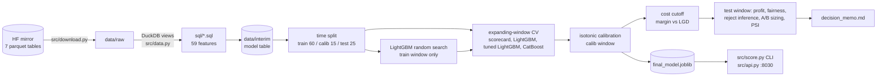

# Credit default model and lending policy experiment (Home Credit)

A credit model is only worth what the lending decision built on it earns. This project takes the real seven-table Home Credit
dataset (307,511 applications, 8.07% default rate), engineers 59 features in tested DuckDB SQL, compares a bank-style WoE scorecard
with LightGBM and CatBoost under time-ordered validation, calibrates the winner, and then turns it into a cost-based approval
cutoff. That cutoff is checked for profit against approve-all and a legacy rule, for fairness by gender and area rating, for
selection bias via a reject inference simulation, and sized as an A/B pilot, ending in a one-page memo for a credit head
(`outputs/decision_memo.md`). A small CLI and API score one applicant with PD, decision and adverse-action style reasons.

Data: Hugging Face mirror `mohameddhameem/home-credit-default-risk`. Every number below comes from one run of `python -m src.run`
on 2026-10-14 (x86_64, 12 logical cores, CPU only, models capped at 4 threads, 9.3 minutes), stored in `outputs/metrics.json`
and the CSVs next to it. Log: `outputs/run.log`.

## Headline results (test window, 76,878 applications, never used for fitting, tuning or cutoff choice)
| What | Result | Source |
|---|---|---|
| Final model | LightGBM (random-search params) + isotonic calibration | `metrics.json` `final_model` |
| Test AUC / Gini / KS | 0.782 / 0.564 / 0.431 raw scores (after isotonic: 0.782 / 0.564 / 0.429; scorecard: 0.762 / 0.524 / 0.396) | `metrics.json` `test_raw`, `test_calibrated` |
| Calibration error (ECE) after isotonic | 0.0034 | `metrics.json` `test_calibrated` |
| Cost cutoff (chosen on calibration window) | approve if PD <= 0.190 | `metrics.json` `policy` |
| Profit vs approve-all | +0.250e9 (+5.7%) at 91.0% approval; default rate of approved 7.97% -> 5.79% | `policy_comparison.csv` |
| Fairness at cutoff (approval ratio, lowest vs highest group) | gender 0.950, area rating 0.878 | `fairness.csv` |
| A/B pilot vs approve-all | 26,834 per arm, 2.7 weeks at 20,000 apps/week (assumed) | `metrics.json` `ab` |

## Architecture


## Quickstart
```
pip install -r requirements.txt   # or: source $ML_VENV/bin/activate
python -m src.download            # about 1.1 GB of parquet into data/raw/
python -m src.run                 # about 9 minutes on 4 CPU threads; writes outputs/ and outputs/final_model.joblib
```
No data? `python -m src.run --synthetic` runs the whole pipeline on a generated fake seven-table set (`src/synth.py`)
and writes to `outputs/synthetic/`. Those numbers are plumbing checks, not results.

## Demo: score one applicant
```
python -m src.score 367197                    # an SK_ID_CURR from the test window
python -m src.score --raw '{"AMT_CREDIT": 900000, "AMT_INCOME_TOTAL": 120000, "AMT_ANNUITY": 45000, "DAYS_BIRTH": -9000, "EXT_SOURCE_2": 0.2}'
uvicorn src.api:app --port 8030               # GET /score/{sk_id_curr}, POST /score (raw fields as JSON), GET /health
```
Output: calibrated PD, `approve`/`decline` under the cost cutoff, expected profit if approved, and the top 4 features that pushed
risk up (SHAP log-odds, with plain-language reason text), plus the observed outcome for test-window ids. Example: 367197 gets
PD 0.2449, decline; first reason "Credit granted vs amount requested on previous applications". Raw mode runs the committed
`sql/01_application.sql` on the single row; fields left out, including all bureau and previous-loan history, count as missing,
which the model treats like an applicant with no record. Ids outside the test window are refused, because the model was trained on them.

## Read this before trusting any number
1. **The dates are not real.** The `application_train_dated` table has an `application_date` column (2018-01 to 2020-12) added by the dataset
   uploader; original Home Credit has no dates. Monthly default rate is flat (7.6% to 8.7% across all 36 months, `outputs/default_rate_by_month.csv`) and score PSI is about 0, consistent with dates
   assigned without regard to behaviour (inference, not verified). So the "time-aware" splits are mechanically correct but do **not** test real drift,
   and the PSI monitoring result (max 0.003) is a plumbing demo, not evidence of stability.
2. **Margin (15% of AMT_CREDIT) and LGD (60%) are my assumptions**, not data (`src/config.py`). The profit numbers and the chosen cutoff depend on them. Sensitivity table: `outputs/policy_sensitivity.csv`.
3. **Outcomes exist only for granted loans.** Reject inference here is a simulation: treat the full set as through-the-door, apply a made-up legacy rule, hide rejected labels, and measure damage. The "legacy rule" is my own crude rule, not Home Credit's real policy.
4. Profit units are the dataset's (unnamed) currency. A/B results are a bootstrap simulation on the test window using observed outcomes as counterfactuals, not a live test. Real defaults take months to mature.
5. **Tuning bought nothing real.** The LightGBM random search (8 trials) gained +0.0008 AUC on its validation slice and +0.0006 on test. Its CV number is slightly optimistic,
   because the tuning slice (last 20% of the train window) overlaps the later CV validation folds. The test window was never touched by tuning, and the
   tuned and untuned LightGBM are within 0.001 test AUC of each other (0.7822 vs 0.7817). The policy tables were computed for the tuned model only; an
   earlier untuned run gave a similar profit gain, but that run's outputs were not kept, so no number is quoted for it.
6. `age_years` and `REGION_RATING_CLIENT` are model inputs; `CODE_GENDER` is not. Age can show up as an adverse-action reason, which a real lender would have to clear with compliance.

## Pipeline
- `sql/*.sql`: DuckDB feature SQL, one file per table plus `99_model_table.sql`. 59 model features. `tests/test_sql.py` runs it on a hand-made dataset with exact expected values.
- `src/woe.py`: WoE binning plus L2 logistic scorecard (IV filter at 0.02, 36 features kept), with reason-code contributions.
- `src/models.py`: LightGBM 4.7 (fixed params, plus an 8-trial random search fitted on the first 80% of the train window and scored on the last 20%), CatBoost 1.2.10 (one fixed config: 600 iterations, depth 6, lr 0.06, native categoricals, not tuned), Platt and isotonic calibration.
- Split by (assigned) date: train 60% (2018-01 to 2019-10), calibration 15%, test 25% (2020-04 to 2020-12). Expanding-window CV (4 folds) on train+calibration.
- Final model rule, fixed before looking at test: highest mean CV AUC, then isotonic calibration fitted on the calibration window.
- `CODE_GENDER` is excluded from the models and used only for the fairness slice.

## Results (test window, 76,878 applications)
| Model | CV AUC (4 expanding folds) | Test AUC | Gini | KS | ECE | Brier |
|---|---|---|---|---|---|---|
| WoE scorecard | 0.755 +/- 0.008 | 0.762 | 0.524 | 0.396 | 0.0019 | 0.0670 |
| LightGBM (fixed params) | 0.776 +/- 0.007 | 0.782 | 0.563 | 0.429 | 0.0037 | 0.0656 |
| **LightGBM (random search)** | **0.776 +/- 0.008** | **0.782** | **0.564** | **0.431** | **0.0037** | **0.0655** |
| CatBoost (fixed params) | 0.774 +/- 0.008 | 0.780 | 0.559 | 0.421 | 0.0038 | 0.0657 |

Raw (uncalibrated) scores; same splits and metrics for all four. Search detail: `outputs/lgbm_random_search.csv` (best: 15 leaves, lr 0.08,
500 trees, min_child_samples 100, colsample 0.5, lambda 20). The three GBMs are within noise of each other; the scorecard is about 0.02 AUC behind,
the usual price of an interpretable linear model.

Calibration (fitted on the calibration window): final model ECE 0.0037 raw, 0.0037 Platt, 0.0034 isotonic. All models were already well calibrated
(the scorecard is a logistic regression, the GBMs are regularised), so calibration changes almost nothing; isotonic was kept for the policy.
SHAP values are the final model's native TreeSHAP (`outputs/shap_importance.csv`, `shap_top15.png`; no `shap` package needed):
`ext_source_mean` dominates (0.30 mean |log-odds|, next `pos_cnt_instalment_mean` 0.14).

### Cost-based approval policy (margin 0.15, LGD 0.60, break-even PD 0.20; cutoff chosen on calibration window: PD <= 0.190)
| Policy | Approval | Default rate of approved | Realized profit | vs approve-all |
|---|---|---|---|---|
| Approve all | 100% | 7.97% | 4.365e9 | 0 |
| Legacy rule (reject worst 30% on credit/income, annuity/income, age) | 70.0% | 7.42% | 2.599e9 | -1.766e9 |
| Model, reject same 30% share | 70.5% | 3.60% | 4.159e9 | -0.206e9 |
| **Model, cost threshold** | **91.0%** | **5.79%** | **4.615e9** | **+0.250e9 (+5.7%)** |

Plain reading: with 15% margin and 60% LGD almost everyone is worth approving, so the gain over approve-all is modest (5.7%). The cost threshold beats
rejecting a fixed share, which loses money under these economics. The best cutoff in hindsight on test (88.2% approval, 4.619e9) is within 0.1% of the calibration-chosen one.
Under other assumptions (`policy_sensitivity.csv`) the gain over approve-all ranges from +0.05e9 (margin 0.20, LGD 0.40) to +1.32e9 (margin 0.05, LGD 0.80).

### Reject inference simulation (legacy rule hides 30% of train labels; scored on fully observed test)
| Train data | Test AUC | Test KS | Mean PD on legacy-rejected (actual 9.25%) |
|---|---|---|---|
| All labels (oracle) | 0.7822 | 0.431 | 9.43% |
| Accepted only | 0.7780 | 0.421 | 9.81% |
| Accepted + parceling x1.0 | 0.7770 | 0.416 | 9.88% |
| Accepted + parceling x1.5 | 0.7712 | 0.407 | 14.10% |

Honest result: selection bias barely matters here (AUC -0.0042). The legacy rule uses features the model also sees, so the accepted set is selected on observables
and the GBM extrapolates fine. Parceling did not help and the x1.5 risk multiplier (an assumption) hurts by overshooting PD on rejects. A real rule using unobserved information would behave differently.

### Fairness slice at the chosen cutoff
| Slice | Approval rate | Default rate (approved) | Approval ratio vs highest group |
|---|---|---|---|
| Gender F / M | 92.6% / 88.0% | 5.17% / 7.07% | 1.00 / 0.950 |
| Region rating 1 / 2 / 3 | 97.1% / 91.4% / 85.3% | 3.88% / 5.80% / 7.21% | 1.00 / 0.941 / 0.878 |

`REGION_RATING_CLIENT` is Home Credit's own 1-3 area rating, not a geographic region. Approval gaps follow base default-rate gaps (M 9.99% vs F 6.92%; region 3 10.89% vs region 1 4.55%). Region 3 at 0.878 and gender at 0.950 clear the four-fifths (0.80) rule, but the gaps are real and a lender would need to justify them.

### A/B test of the model policy (bootstrap simulation, alpha 0.05, power 0.80, 20,000 applications/week assumed)
| Baseline | Mean profit/applicant A vs B | Required n per arm (raw / CUPED) | Duration (raw / CUPED) | Empirical power at that n (raw / CUPED) |
|---|---|---|---|---|
| Approve all | 56,779 vs 60,028 (delta 3,250, SD 134,367) | 26,834 / 25,261 | 2.7 / 2.5 weeks | 0.82 / 0.81 |
| Legacy rule | 33,803 vs 60,028 | 295 / 281 | 0.03 weeks | 0.805 / 0.82 |

CUPED (covariate: calibrated PD) cuts variance only 5.9% because profit variance is dominated by who defaults and how large the loan is, not by the pre-score. Weeks ignore default maturation time, which in practice dominates. Memo: `outputs/decision_memo.md`.

### PSI by month
15 months scored (calibration + test), max PSI 0.003, none above 0.10. See caveat 1: this says the assigned dates are exchangeable, not that the model is stable.

## Reproduce and test
```
source $ML_VENV/bin/activate
python -m pytest -q tests        # 22 tests: metrics, policy, WoE, splits, A/B, SQL exact values, synthetic end to end + scoring demo
python -m src.run                # needs data/raw/<table>/*.parquet (python -m src.download); builds data/interim cache; writes outputs/
```
Outputs: `metrics.json`, `default_rate_by_month.csv`, `cv_folds.csv`, `lgbm_random_search.csv`, `policy_comparison.csv`, `policy_sensitivity.csv`, `threshold_sweep.{csv,png}`,
`reject_inference.csv`, `fairness.csv`, `psi_by_month.{csv,png}`, `reliability.png`, `shap_*`, `final_model.joblib` (gitignored, used by the demo).
Note for other tools: `data/` layout is read by other projects (DuckDB views); do not move files there.

Re-checked on 2026-10-27 without retraining: 22 tests pass, every number above was compared against `outputs/metrics.json` and the CSVs,
and both `python -m src.score 367197` and `GET /score/367197` on the API return PD 0.2449, decline, as quoted in the demo section.

## Gaps
- Dates are uploader-assigned, so no real drift or temporal validation; PSI is a demo.
- Reject inference is a simulation with a self-made legacy rule; no real reject data exists in this dataset.
- Hyperparameter search is deliberately small (8 random trials, LightGBM only). CatBoost is one untuned config. More search is unlikely to matter given the three GBMs already sit within 0.003 AUC.
- The scoring demo serves the model trained on the train window (the one evaluated above), not a refit on all data.
